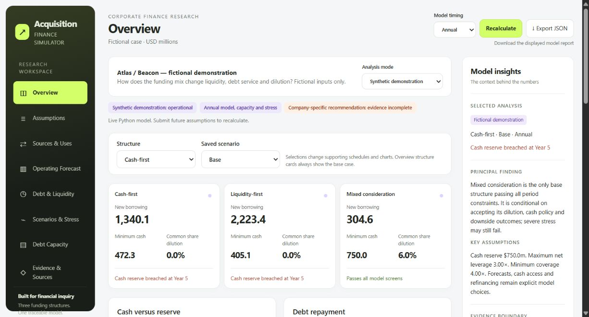

# Acquisition Financing & Debt Capacity Simulator

How does paying for an acquisition with cash, borrowing or shares change liquidity, debt service and dilution? This lightweight Python project connects sources and uses, five-year operations, instrument-level debt and cash schedules, scenario analysis, debt capacity and reverse stress.



The October dashboard redesign adds eight sidebar sections, live timing controls, a model-insight panel and JSON download. Saved scenario selection updates supporting schedules and charts; overview comparison cards stay on the base case.

Three clearly separated modes share the same calculation engine:

| Scope | Current result | Meaning |
|---|---|---|
| Fictional Atlas / Beacon | Cash-first capacity $948m annual; $928m quarterly | At $948m borrowing, quarterly cash falls $24.3m below the $750m reserve. |
| DICK’S / Foot Locker public-information case | Projected closing accounting cash $1,336.9m / $96.1m | Conditional forecasts from information published by 15 May 2025, not actual closing balances. |
| Public financing comparison | All three base structures breach screens | Mixed consideration passes the lower-investment/no-dividend case and a 1pp linked growth penalty, but fails a 2pp penalty. |
| Strict actual-company recommendation | **Blocked — insufficient verified evidence.** | 23 material strict requirements remain unresolved; software operation is independent of this status. |

## Run it

Python 3.11 or newer. Run these commands from this repository folder:

```powershell
python -m venv .venv
.venv/Scripts/python -m pip install ".[exports,test]"
.venv/Scripts/python -m financing data/historical.json --demo --serve 8765
```

Open **http://127.0.0.1:8765**. Choose the public case in **Analysis mode**, edit **Assumptions**, then select **Recalculate live model**. On macOS/Linux use `.venv/bin/python`. No API key, database server or Node installation is required. Core calculations use only the Python standard library.

```powershell
# Synthetic demonstration with quarterly capacity and reverse stress
python -m financing data/historical.json --demo --frequency 4 --output generated --excel --pdf
# Conditional public case, with editable future assumptions
python -m financing data/historical.json --public-information --public-assumptions data/public-assumptions.json --output public-generated --database public-generated/model.sqlite --excel --pdf
# Verification
python -m unittest discover -s tests -v
python scripts/verify_pipeline.py generated data/historical.json
python scripts/verify_public.py public-generated
```

After installation, use the environment's Python for each command (or activate it). Public and strict historical runs intentionally return exit code **2** while the strict recommendation is blocked; supported outputs are still written. Synthetic runs return 0. Exit 2 can also indicate invalid input—inspect the CLI `error` field.

Saved examples: [synthetic dashboard](full-output/dashboard.html), [public dashboard](public-output/dashboard.html), and [strict assessment](historical-output/dashboard.html). Saved dashboards support scenario selection; assumption recalculation requires the live server. The saved output folders include the workbook, two-page PDF memo, JSON report and source/gap registers. SQLite databases are generated locally when running the model and are excluded from version control. Workbook formulas show selected reconciliations; forecasts and capacity are Python snapshots, not a separate Excel engine.

## What makes the analysis defensible

- Annual/quarterly timing flows through model, capacity and reverse stress. Closing constraints are checked too.
- Reported accounting costs reconcile to starting EBITDA; fixed/variable behaviour is an explicit sensitivity.
- Projected trade working capital connects the closing cash bridge to subsequent operating cash flow.
- Financing uses are itemised. Fees can follow actual issued debt or an explicitly fixed original fee budget.
- Every historical observation has a dated source, units and exact-value review claim. Source removal blocks dependent outputs without importing synthetic values.
- The interface distinguishes live edits, saved scenarios, stale results and strict evidence restrictions.

## Limits and reading guide

This is an educational model, not executable financing advice. Actual covenant compliance, lender commitments and private consent/exceptional settlement obligations are unsupported. Public forecasts are annual; cash accessibility, cost behaviour, reinvestment, future prices and refinancing are assumptions. Negative post-breach balances describe funding deficits, not a financed path. Scenario ranges are exploratory, not proven bounds on private obligations.

Start with [the interview walkthrough](LEARNING.md), then [methodology](METHODOLOGY.md), [current public-case review](PUBLIC_CASE_REVIEW.md), [requirement map](REQUIREMENTS.md) and [verification record](VERIFICATION.md). The original [109-input review](INPUT_REVIEW.md) and [scope amendment](PUBLIC_INFORMATION_POLICY.md) remain intact. Earlier narrative results are preserved under `legacy/2026-09-16`; `example-output` is a legacy foundation example, not the current simulator.

Automated checks do not constitute independent source verification. **Source and saved examples are published on GitHub. Live recalculation runs on your local Python server.**
